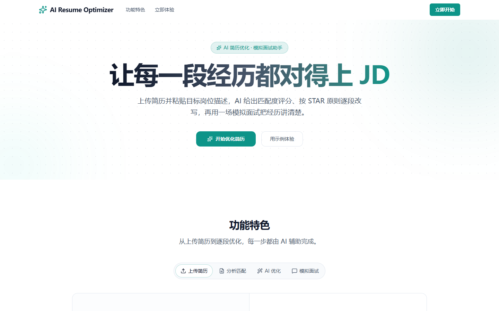
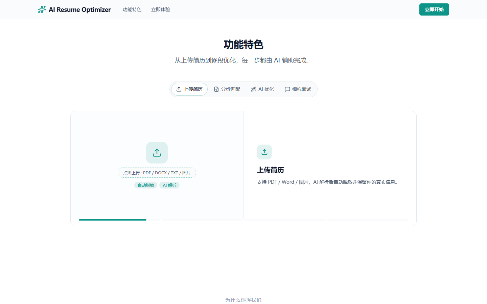
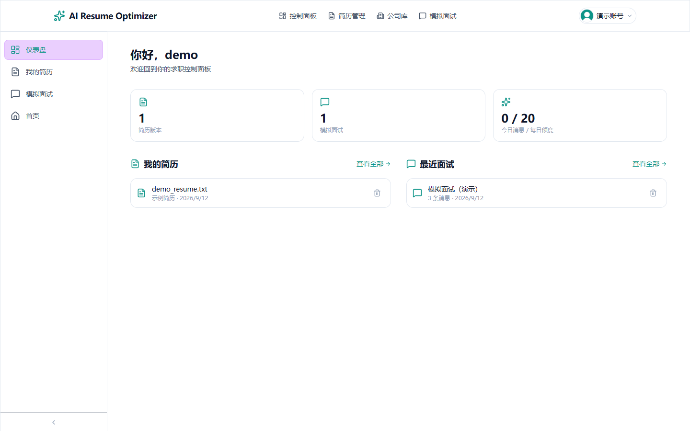
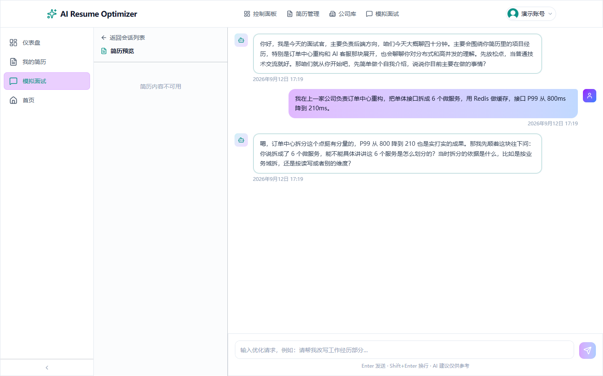
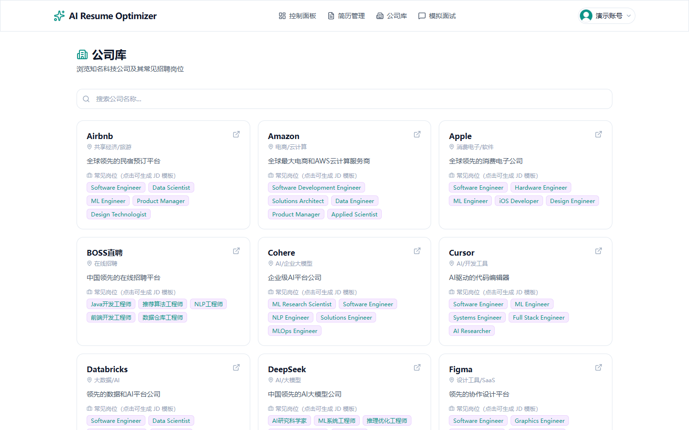
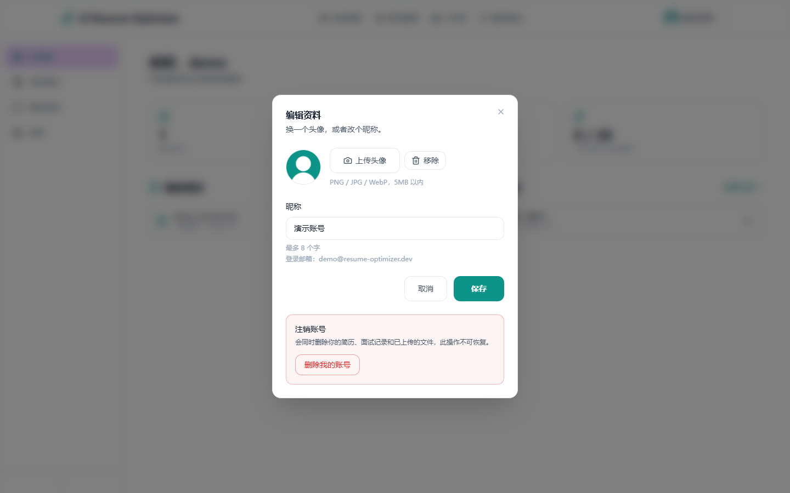

# AI Resume Optimizer · AI 简历优化平台

上传简历、粘贴目标岗位 JD，得到可解释的匹配度评分与逐段改写建议；再开一场 AI 模拟面试，把简历里的经历真正讲清楚。

**在线体验：** <http://47.119.113.82> — 演示账号 `demo@resume-optimizer.dev` / `demo1234`（已预置一份示例简历和一场模拟面试记录）

> 演示账号是公开的、仅用于试用，请不要上传真实个人信息。

---

## 界面预览

以下截图取自线上演示环境（Edge 无头浏览器实拍，非设计稿）：

| 落地页 | 功能特色（含模拟面试） | 控制面板 |
|---|---|---|
|  |  |  |

| AI 模拟面试（面试官逐轮追问） | 公司库 | 编辑资料（头像 / 昵称 / 注销） |
|---|---|---|
|  |  |  |

## 核心功能

| 功能 | 说明 |
|------|------|
| 账号体系 | 邮箱注册登录，JWT（access + refresh 双 token），bcrypt 存储密码；`is_premium` 区分免费/会员两档（配额与所选模型不同，暂无自助升级入口，由数据库字段控制） |
| 简历管理 | 支持 PDF / DOCX / TXT / 图片上传，服务端解析正文并保留原始文件 |
| 隐私脱敏 | 姓名、手机号、邮箱、身份证等 PII 自动替换为 `[已隐藏]`，送给模型的是脱敏文本 |
| 图片简历 OCR | 用 Qwen-VL 视觉模型识别图片简历，并自动裁出证件照作为简历头像 |
| JD 匹配分析 | 把岗位描述解析成结构化要求，逐条比对经历，输出匹配度评分、缺失关键词与改进建议 |
| AI 优化建议（快速模式） | 按 STAR 原则逐段改写、量化成果，SSE 流式输出，支持一键复制全文 |
| AI 优化建议（Agent 模式） | 先规划、再执行：顺序调用「查版块 / 查关键词覆盖 / 检索写法知识库 / 打匹配分 / 改写版块」等工具，全过程轨迹可见，改写结果自动合并回简历 |
| 跨任务记忆 | 记住长期偏好（目标岗位、风格、禁忌）；用户手设的偏好优先级最高，Agent 不能覆盖 |
| AI 模拟面试 | 面试官围绕简历里的项目和经历逐轮追问，一次只问一个问题（prompt 明确禁止一次抛多条），SSE 流式；随时可以让它点评回答或总结整场表现 |
| 公司库 | 内置 50+ 互联网公司及其常见岗位，点击岗位可直接生成 JD 草稿 |
| 个人资料 | 头像上传（服务端居中裁剪并压缩）与昵称编辑 |
| 账号注销 | 一键删除账号：简历、JD、面试会话与消息全部清除，磁盘上的原始文件与头像也一并删除（先提交事务再删文件，避免数据库指向已删除的文件） |
| 用量配额 | 免费用户每日面试消息条数上限（默认 20 条，`FREE_DAILY_MESSAGE_LIMIT` 可配）；额度在调用模型前预占、模型失败则回滚，超限返回 429，控制面板实时显示「今日消息 / 每日额度」 |

## 系统架构

```text
                        ┌───────────────────────────────┐
   浏览器 ─────────────▶│  nginx :80（唯一入口）         │
                        │  /      → 前端容器 :3000       │
                        │  /api/  → 后端容器 :8000       │
                        │  SSE 关闭 proxy_buffering      │
                        └───────┬───────────────┬───────┘
                                │               │
                    ┌───────────▼────────┐  ┌───▼──────────────────────┐
                    │ Next.js 16         │  │ FastAPI (Python 3.12)    │
                    │ App Router + TS    │  │ SQLAlchemy 2.0 async     │
                    │ Zustand / Query    │  │ JWT 中间件 / Pydantic v2 │
                    └────────────────────┘  └───┬──────────┬───────────┘
                                                │          │
                                     ┌──────────▼───┐  ┌───▼──────────┐
                                     │ PostgreSQL 15│  │ Redis（配额）│
                                     └──────────────┘  └──────────────┘
                                                │
                                     ┌──────────▼──────────────────────┐
                                     │ DeepSeek（面试追问 / 改写）      │
                                     │ Qwen-VL via DashScope（图片 OCR）│
                                     └─────────────────────────────────┘
```

### 一次「简历优化」的完整链路

1. 前端把文件 POST 到 `/api/resumes/upload`，后端落盘并解析出正文；
2. 正文经 `anonymizer` 脱敏后写入 `anonymized_text`，真实文本单独留在 `content` 供预览与导出，**只有脱敏文本会发给模型**；
3. `/api/jd/parse` 把 JD 结构化并返回匹配度报告（评分、命中/缺失关键词、改进建议）；
4. `/api/resumes/{id}/polish` 用 SSE 流式返回逐段改写结果，nginx 侧关闭响应缓冲，首字延迟 1 秒内；
5. 模拟面试由 `/api/chat/start` 建立会话，后端先让模型生成一段面试官开场白（best-effort，失败不影响会话），之后 `/api/chat/{id}/message` 带着历史上下文逐轮追问，同样是 SSE；
6. 面试消息在调用模型前先原子预占一个免费额度（并发请求无法一起挤过上限），模型异常时把额度退回；计数存 Redis 以跨 worker 共享，未配置 Redis 时退化为进程内计数。

## Agent 架构

早期版本的「AI 优化建议」是一次 prompt 调用：把简历和 JD 塞进上下文，让模型直接写建议。
效果不算差，但**不可解释、不可控、不可回归**——模型没有机会去查证，用户也看不到结论从哪来，
改了 prompt 也无从判断是变好还是变差。现在同一条业务链路由一个真正的 Agent 执行：

```text
       ┌──────────────┐
目标 ─▶│ 规划器 Planner│  拆成 3–5 步（JSON），失败则退回内置兜底计划
       └──────┬───────┘
              ▼
       ┌──────────────────────────────────────────────┐
       │ 执行循环 Executor（步数上限 / 同工具调用上限） │
       │  模型 → 工具调用 → 观察值 → 再决策 → ……      │
       └───┬──────────┬──────────┬──────────┬─────────┘
           ▼          ▼          ▼          ▼
      确定性工具    模型工具    长期记忆   上下文压缩
      （不花 token） （打分/改写） （跨任务）  （超预算摘要）
              │
              ▼
       ┌──────────────┐        ┌────────────────────┐
       │ 报告 + 改写稿 │───────▶│ 轨迹落库 agent_steps│
       └──────────────┘        └────────────────────┘
```

| 能力 | 实现 | 关键设计 |
|------|------|----------|
| 任务规划 | `app/agent/loop.py::_make_plan` | 先让模型输出结构化计划；规划失败/臆造工具名都不会让任务瘫掉，退回内置兜底计划 |
| 工具调用 | `app/agent/tools.py`（7 个工具） | 5 个确定性工具（查版块 / 查关键词 / BM25 检索知识库 / 读记忆 / 写记忆）+ 2 个模型工具（打分 / 单段改写），每个都有参数校验、超时与异常兜底 |
| 记忆管理 | `app/agent/memory.py` | 短期：执行上下文超预算时摘要压缩，保留段始终从 assistant 消息切起（否则 tool 消息会失去配对、请求直接被判非法）；长期：`user_preferences` 跨任务保留，写入有上限，且不能覆盖用户手设的值 |
| 可靠性 | 循环内四道闸门 | 步数上限、同工具调用次数上限、单工具超时、连续失败触发重规划；模型不支持 function calling 时自动降级为单次改写 |
| 可观测 | `agent_runs` / `agent_steps` | 规划、每次工具调用（参数 / 耗时 / 结果）、压缩、重规划、收尾逐条落库，前端可实时看轨迹、事后可复现 |
| 幻觉兜底 | `app/agent/utils.py::unsupported_numbers` | 改写稿里出现、但原文（含整份简历）没有的数字会被标出来——模型最爱把「参与优化」写成「提升 40%」 |
| 效果评测 | `backend/evals/` | 27 条离线用例量四类确定性能力（版块召回 / 关键词判定 / 检索 recall@3 与 MRR / 数字检查），当前指标全部 1.0，并带阈值卡回归（`python -m evals.run_evals`） |

工具清单（模型自己决定调哪些、调几次）：

| 工具 | 类型 | 作用 |
|------|------|------|
| `list_resume_sections` | 确定性 | 按版块切分简历，返回名称/字数/预览——避免每轮都塞全文 |
| `check_keywords` | 确定性 | 关键词覆盖检查（英文按词边界、中文按子串），不消耗模型额度 |
| `search_knowledge` | 确定性 | BM25 检索简历写法知识库（30 条方法论，中文按二元组分词） |
| `recall_user_context` | 确定性 | 读长期记忆：偏好、最近看过的岗位、以往任务用过哪些工具 |
| `remember_preference` | 确定性 | 写长期记忆（有上限、有键名规则、不能覆盖用户手设值） |
| `score_resume_match` | 模型 | 结构化打分，输出经 Pydantic 校验与容错 |
| `rewrite_resume_section` | 模型 | 改写单个版块，附带数字幻觉检查与风险提示 |

## 可验证证据

> 下面每个数字都标了口径与复现命令。**脱离口径的数字不要引用**——这是这个项目最容易被
> 追问的地方，也是最容易露怯的地方。

### 测试

| 项目 | 数字 | 复现 |
|------|------|------|
| 后端 pytest | **103 passed**（其中 Agent 相关 58 个：循环 / 工具 / 记忆 / 接口 / 统计口径） | `cd backend && python -m pytest -q` |
| 前端 vitest | **36 passed** | `cd frontend && npm run test` |
| 迁移一致性 | `alembic check` 无差异；`upgrade → downgrade → upgrade` 通过 | `cd backend && alembic check` |
| 前端生产构建 | `next build` 通过（含 TypeScript 检查） | `cd frontend && npm run build` |

### 离线评测（`backend/evals/`）

27 条固定用例、5 项确定性指标，当前全部 **1.0**：

| 指标 | 值 | 用例数 |
|------|----|--------|
| 版块识别 recall | 1.0 | 4 |
| 关键词判定 accuracy | 1.0 | 6 |
| 知识库检索 recall@3 / MRR | 1.0 / 1.0 | 10 |
| 数字幻觉检查 accuracy | 1.0 | 5 |
| 报告结构检查 accuracy | 1.0 | 2（含自检） |

复现：`cd backend && python -m evals.run_evals`（跌破阈值会以非 0 退出码结束）。

**口径**：只覆盖不依赖模型的那一半能力，不含生成质量。模型质量由下面的在线指标与人工
抽检衡量——把两者混成一个数字，会得到一个每次都在变、谁也不敢信的指标。

### 端到端采样（12 次真实任务）

`deepseek-chat`，同一份简历 + 同一个 JD，`max_steps=6`，每次独立账号（长期记忆互不影响）：

| 指标 | 值 |
|------|----|
| 任务成功率 | **12/12（100%）**，结束原因全部为 `completed` |
| 任务耗时 P50 / P95 | 24.9s / 26.9s（`agent_runs.duration_ms`，即 Agent 循环耗时） |
| 模型调用步数（平均） | 9.1 步 |
| 工具调用 | **85 次，失败 0 次** |
| token | 合计 231,757，平均 19,313/次 |
| 单工具 P50 | 确定性工具 0–10ms；模型工具 1.9–2.8s |

复现：`cd backend && python scripts/bench_agent.py --runs 12`，再用
`python scripts/agent_stats.py --last 12` 从数据库复核同一批数据。

**口径与限制**：成功 = 任务走到 `completed`，**不代表报告质量**；样本 12 次、单一简历/JD
组合，只能作为方向性证据。想扩大样本直接改 `--runs`。

### 快速模式 vs Agent 模式（同输入，n=1）

| | 快速模式 `/resumes/{id}/polish` | Agent 模式 `/agent/optimize` |
|---|---|---|
| 耗时 | 13.6s | 26.5s |
| 模型调用 | 1 次 | 10 次（1 规划 + 8 工具轮 + 1 收尾） |
| 工具调用 | 0 | 8 次（5 种工具） |
| 报告字数 | 4452 | 4333 |
| token | 未统计 | 21,909 |
| 报告含匹配度分数 | 否 | 是（62/100，来自 `score_resume_match`） |

结论：Agent 的差别不在"写得更长"，而在**过程可验证**（轨迹可回放、关键词覆盖与匹配分
来自确定性工具、改写稿带幻觉检查）。代价是约 2 倍延迟与约 2 万 token/次。n=1，方向性证据。

## 技术栈

| 层 | 选型 |
|----|------|
| 前端 | Next.js 16（App Router）、TypeScript、Tailwind CSS 4、Zustand、TanStack Query |
| 后端 | FastAPI、SQLAlchemy 2.0（async）、Pydantic v2、python-jose、passlib + bcrypt |
| 数据 | PostgreSQL 15、Redis 7（本地开发可退化为 SQLite，无需 Redis） |
| AI | DeepSeek（OpenAI 兼容协议，可替换）、Qwen-VL（DashScope，图片简历 OCR） |
| 部署 | Docker Compose（db / redis / backend / frontend / nginx）、阿里云 ECS |

## 工程实践

- **测试**：后端 103 个 pytest 用例（`backend/tests`）+ 前端 36 个 Vitest 用例（`frontend/tests`）。后端测试自备独立 SQLite 与临时上传目录，不依赖 Postgres、Redis 或任何 API Key，覆盖脱敏边界、迁移与模型一致性、账号资料链路、密码策略与登录限流、免费额度真的会拦下第 21 条消息、注销账号后不残留孤儿行与磁盘文件、孤儿文件清理脚本只删未被引用的文件、模拟面试会话的生命周期与所有权隔离（别人的会话一律 404），以及 Agent 的规划 / 工具调用 / 参数校验 / 超时 / 重规划 / 步数上限 / 上下文压缩 / 降级 / 长期记忆冲突 / 轨迹落库与越权隔离；前端用 Testing Library 覆盖头像回退、昵称校验边界、先传图再保存、非图片文件被拒、注册页校验、注销需二次确认、404 与错误边界、API 错误透传，以及 Agent 轨迹面板的渲染与降级提示。
- **Agent 怎么验证**：Agent 的模型调用全部走可注入的假模型（`tests/agent_fakes.py`），所以「循环会不会死循环、工具失败会不会重规划、上下文压缩会不会把 tool 消息切散」这些最容易出问题的路径都有确定性用例；模型本身的效果则用 `backend/evals/` 的离线指标 + `agent_runs` 里的在线指标（步数、工具失败率、token 消耗）分开衡量，不混成一个数字。
- **数据生命周期**：删除简历会带走原始文件与裁剪头像，替换头像会删掉旧文件，注销账号会清空该用户的全部数据与文件；文件一律在事务提交之后才删除，避免数据库指向已不存在的文件。历史上用 psql 直接删行留下的孤儿文件，可以用 `backend/scripts/prune_orphan_uploads.py` 先 dry-run 列出、再加 `--delete` 清理。
- **认证与滥用防护**：注册密码限定 8–72 位（上限正好是 bcrypt 72 字节的截断边界，超长直接拒绝而不是静默截断）；登录按「客户端 IP + 邮箱」维度做失败限流，同一组合连续失败 5 次后返回 429，15 分钟窗口，登录成功即清零——按 IP+邮箱而不是仅按邮箱计数，避免攻击者用失败尝试把受害者锁在门外。
- **用量配额**：`quota_service` 用「先预占、失败回滚」的方式执行免费额度，避免并发请求绕过上限；Redis 不可用时不静默放行，而是退化为进程内计数（有测试覆盖第 21 条消息被拒的场景）。
- **数据库迁移**：schema 由 Alembic 版本化管理（`backend/alembic/versions`），应用启动不再建表。测试库本身就是用 `alembic upgrade head` 建的，另有一条测试跑 `alembic check`，一旦有人改了模型却没加迁移就会失败。
- **CI**：`.github/workflows/ci.yml` 分两个 job，后端跑 `pytest`，前端跑 `eslint` + `vitest` + `next build`。
- **配置分层**：`APP_ENV=local` 时读 `backend/.env.local`（SQLite、关闭 Redis），否则读 `backend/.env`（Postgres + Redis），由 `app/config.py` 统一决定；密钥只存在于环境变量，仓库里只有 `.env.example`。
- **上传与 URL 约定**：文件保存在 `UPLOAD_DIR`，对外一律通过 `app/services/storage.py` 转成 `/uploads/<name>` 形式的 URL，避免把服务器文件路径返回给浏览器。
- **反向代理**：前端构建时把 `NEXT_PUBLIC_API_URL` 注入为相对路径 `/api`，同一个镜像在 localhost 和任意域名下都不用重新构建。
- **容器**：前端用 Next 的 `output: "standalone"`，只把服务端真正依赖的模块装进运行镜像（`node server.js` 启动），镜像从 930 MB 降到 230 MB、运行时内存约 60 MB；后端镜像带 `.dockerignore`，构建上下文排除虚拟环境与上传文件，体积从 417 MB 降到 286 MB。
- **健壮性**：后端健康检查探 `/health`、前端探首页，nginx 会等两个上游都 healthy 再启动，因此 `docker compose ps` 的状态就是真实可用性；前端有路由级错误边界（可重试）和自定义 404 页，不会掉到 Next 默认的英文报错页。

## 性能实测

演示环境是阿里云 ECS（2 vCPU / 2 GiB，Alibaba Cloud Linux 3），单 uvicorn worker，PostgreSQL 与 Redis 同机。用 `backend/scripts/bench_api.py` 每项采样 15 次（脚本只打非模型接口，可安全对生产重复运行）：

| 接口 | 容器内直连后端（中位 / P95） | 经 nginx 反代（中位） | 公网往返（中位） |
|------|------|------|------|
| `GET /health` | 2.2 / 2.8 ms | 3.4 ms | 27.3 ms |
| `GET /resumes` | 8.5 / 9.2 ms | 11.9 ms | 37.6 ms |
| `GET /resumes/{id}` | 8.6 / 9.4 ms | 15.6 ms | 38.3 ms |
| `GET /companies/search` | 7.3 / 12.0 ms | 9.9 ms | 34.7 ms |
| `GET /chat/sessions` | 8.7 / 9.1 ms | 9.9 ms | 39.6 ms |
| `GET /auth/me/stats` | 11.0 / 16.1 ms | 10.2 ms | 35.9 ms |
| `POST /auth/login` | 291.7 / 314.6 ms | 292.1 ms | 317.4 ms |

读接口的服务端处理在 7–16 ms 区间，nginx 反代只增加 1–5 ms，公网往返约 25 ms（华南机房）。唯一明显的慢点是登录：290 ms 几乎全部花在 bcrypt 哈希上（成本因子 12，刻意让哈希慢一些以抵抗离线爆破），也正因如此，登录接口的失败限流同时承担了防爆破与保护 CPU 两个作用。复现方式：`docker compose exec backend python scripts/bench_api.py http://127.0.0.1:8000`。

## 目录结构

```text
resume-optimizer/
├── backend/
│   ├── app/
│   │   ├── agent/        # Agent 机制：规划器、执行循环、工具集、记忆、文本工具函数
│   │   ├── api/          # auth / resumes / companies / jd / chat / agent 路由
│   │   ├── models/       # SQLAlchemy ORM 模型
│   │   ├── schemas/      # Pydantic 请求/响应模型（含对模型输出的容错）
│   │   ├── services/     # 业务逻辑：AI、脱敏、解析、配额、存储
│   │   ├── data/         # 简历写法知识库（Agent 检索工具的数据源）
│   │   ├── middleware/   # JWT 鉴权
│   │   ├── config.py     # 环境分层（.env / .env.local）
│   │   └── main.py       # 应用装配、静态挂载、启动期建表与种子数据
│   ├── tests/            # pytest 用例与隔离 fixture
│   ├── evals/            # Agent 离线评测集与评测脚本
│   ├── scripts/          # 种子数据、接口压测、Agent 采样与可靠性统计
│   ├── alembic/          # 版本化迁移（基线 + 后续 revision）
│   └── requirements*.txt
├── frontend/
│   ├── app/              # App Router 页面（landing / auth / dashboard / chat / companies）
│   ├── components/       # 按功能分目录的组件
│   ├── lib/              # API 客户端、鉴权与工具函数
│   ├── stores/           # Zustand 状态
│   └── tests/            # Vitest + Testing Library 组件/工具测试
├── nginx/nginx.conf      # 唯一入口，/api 反向代理 + SSE 关闭缓冲
├── deploy.sh             # 部署脚本：备份 → 构建 → 迁移 → 启动 → 验证（见 docs/deploy.md）
├── docs/deploy.md        # 部署手册与回滚步骤
├── docker-compose.yml    # db / redis / backend / frontend / nginx
└── .github/workflows/    # CI
```

## 快速开始

### 方式一：Docker Compose（推荐）

```bash
cp backend/.env.example backend/.env   # 填入 OPENAI_API_KEY（DeepSeek）
docker compose up -d --build           # 启动前自动执行 alembic upgrade head
```

访问 <http://localhost>（nginx 在 80 端口统一入口）。

### 方式二：不用 Docker（SQLite）

```bash
cd backend
cp .env.example .env.local   # DATABASE_URL 改成 sqlite+aiosqlite:///./local_dev.db，REDIS_URL 留空
alembic upgrade head         # 建表（schema 由 Alembic 管理）
APP_ENV=local python -m uvicorn app.main:app --reload
```

> 如果本地已经有旧版本建出来的 `local_dev.db`，先执行一次 `alembic stamp head` 标记为最新，不用重新升级。

```bash
cd frontend
npm install && npm run dev
```

> Windows PowerShell：`$env:APP_ENV="local"; python -m uvicorn app.main:app --reload`

> 想在本机用生产模式预览前端：`npm run build` 后执行 `npm start`（standalone 服务端）。若页面样式缺失，把 `.next/static` 与 `public` 拷进 `.next/standalone/` 即可——容器镜像里这一步由 Dockerfile 完成。

## 环境变量

| 变量 | 说明 |
|------|------|
| `DATABASE_URL` | `postgresql+asyncpg://…`（Docker）或 `sqlite+aiosqlite:///./local_dev.db`（本地） |
| `REDIS_URL` | 配额计数用；留空则本地开发时跳过 |
| `SECRET_KEY` | JWT 签名密钥，**上线必须换成随机值** |
| `OPENAI_API_KEY` / `OPENAI_BASE_URL` | DeepSeek 或任何 OpenAI 兼容服务 |
| `DASHSCOPE_API_KEY` / `QWEN_VL_MODEL` | 图片简历 OCR；不配置时该功能会明确报错，其余功能不受影响 |
| `CORS_ORIGINS` | 允许的前端来源，逗号分隔 |
| `UPLOAD_DIR` | 上传文件目录，容器内为 `./uploads` |
| `FREE_DAILY_MESSAGE_LIMIT` | 免费用户每日消息上限 |
| `AGENT_MAX_STEPS` | Agent 单次任务最多执行多少步（默认 8），防死循环烧额度 |
| `AGENT_MAX_SAME_TOOL_CALLS` | 同一个工具在单次任务里的调用上限（默认 3） |
| `AGENT_TOOL_TIMEOUT_SECONDS` | 单个工具调用超时秒数（默认 60） |
| `AGENT_CONTEXT_TOKEN_BUDGET` | 执行上下文超过该估算 token 数就触发摘要压缩（默认 8000） |
| `AGENT_MAX_PREFERENCES` | 长期记忆最多保存多少条键值（默认 20） |
| `AGENT_ENABLED` | 设为 `false` 时 `/agent/optimize` 直接退回单次改写链路 |

## 测试与检查

```bash
# 后端：103 个用例，使用独立 SQLite，不依赖外部服务
cd backend && pip install -r requirements.txt -r requirements-dev.txt && python -m pytest
```

```bash
# Agent 离线评测：版块识别 / 关键词判定 / 知识库检索 / 数字幻觉检查
# 指标跌破阈值时以非 0 退出码结束（CI 就是这么卡的）
cd backend && python -m evals.run_evals
```

```bash
# 前端：36 个用例（jsdom + Testing Library）
cd frontend && npm run test
```

```bash
# 前端：测试 + 生产构建（含类型检查）+ lint
cd frontend && npm run test && npm run build && npm run lint
```

## API

所有业务接口都在 `/api` 前缀之后（nginx 剥离前缀转发给后端）。

| 方法 | 路径 | 说明 |
|------|------|------|
| POST | `/auth/register` · `/auth/login` · `/auth/refresh` | 注册 / 登录 / 刷新 access token |
| GET · PATCH · DELETE | `/auth/me` | 当前用户 / 修改昵称（1–8 字）/ 注销账号（连同数据与上传文件一并清除） |
| POST · DELETE | `/auth/me/avatar` | 上传（服务端裁剪为 256×256 PNG）/ 删除头像 |
| GET | `/auth/me/stats` | 简历数、会话数、今日用量与上限 |
| POST | `/resumes/upload` | 上传并解析简历（PDF / DOCX / TXT / 图片） |
| GET · DELETE | `/resumes` | 简历列表 / 全部清空 |
| GET · DELETE | `/resumes/{id}` | 单份简历详情 / 删除 |
| POST | `/resumes/{id}/parse` | 重新做结构化解析 |
| POST | `/resumes/{id}/polish` | AI 逐段改写（SSE 流式） |
| GET | `/resumes/{id}/export` | 导出优化后文本（.txt） |
| POST | `/agent/optimize` | Agent 优化简历：规划 → 工具调用 → 报告（SSE 流式，逐帧带执行轨迹） |
| GET · DELETE | `/agent/runs` | 我的 Agent 执行记录 / 全部清空 |
| GET · DELETE | `/agent/runs/{id}` | 一次任务的完整轨迹（规划 / 工具 / 压缩 / 收尾）/ 删除 |
| GET · PUT · DELETE | `/agent/preferences[/{key}]` | 跨任务长期记忆的读取 / 写入 / 删除 |
| POST | `/jd/parse` | JD 结构化 + 匹配度分析 |
| GET | `/companies` · `/companies/search` | 公司库分页 / 搜索 |
| POST | `/chat/start` | 新建模拟面试会话（生成面试官开场白） |
| GET · DELETE | `/chat/sessions` | 面试记录列表 / 清空 |
| GET | `/chat/{id}/messages` | 会话消息 |
| POST | `/chat/{id}/message` | 面试问答（SSE 流式） |
| GET | `/health` | 健康检查 |

完整的交互式文档在 `http://<host>/api/docs`（FastAPI Swagger UI）。

## 部署

当前演示环境是阿里云 ECS（2 核 2 GiB，Alibaba Cloud Linux 3）上的 Docker Compose 单机部署：

```bash
git clone <repo> && cd resume-optimizer
cp backend/.env.example backend/.env   # 填 SECRET_KEY、AI Key，CORS_ORIGINS 换成实际域名/IP
docker compose up -d --build
docker compose ps                       # 5 个容器：db / redis / backend / frontend / nginx
```

- `docker-compose.override.yml` 给所有服务加了 `restart: unless-stopped`，机器重启后自动拉起；
- 更新版本：把新代码同步到服务器后执行 `docker compose up -d --build`，重建镜像会保留数据库卷；
- 前端容器重建后 nginx 会缓存旧的上游 IP，需要 `docker compose restart nginx`。

### 小内存机器的运维注意

演示机是 2 GiB 内存。**不要在它上面跑 `docker system df`**：这个命令统计镜像/缓存占用时会让 dockerd 自身吃下 1 GB 以上内存，实测触发过内核级 OOM，把 dockerd 连同五个容器一起杀掉（容器在 dockerd 恢复后按 restart 策略自动回来）。需要看磁盘用 `df -h` 和 `docker images`，需要回收空间用 `docker builder prune -f`（本次清出约 8 GB，代价是下一次构建会全量重建）。

`docker-compose.override.yml` 里给每个服务设了 `mem_limit`，让容器内存溢出只在 cgroup 内被 OOM 掉并自动重启，而不会拖垮宿主机的 Docker 守护进程。

## 已知限制与后续计划

- **水平扩展**：会话状态在 Redis、文件在本地磁盘，多实例部署前需要把上传切到对象存储。
- **lint 债务**：`npm run lint` 已做到 0 error，但仍有 34 条 warning，主要是 API 适配层的 `any`（含 Agent SSE 事件的松散类型）、Agent 轨迹面板的事件字段 `any`，以及数据获取写法的 `react-hooks/set-state-in-effect`。
